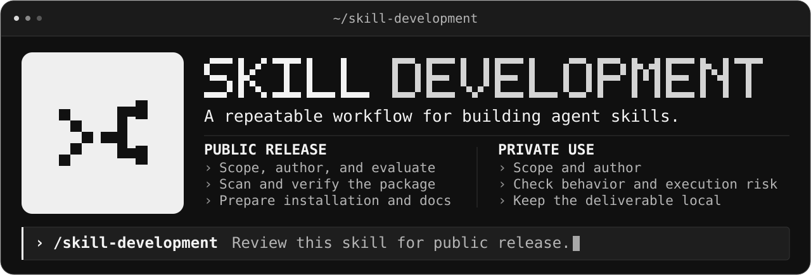
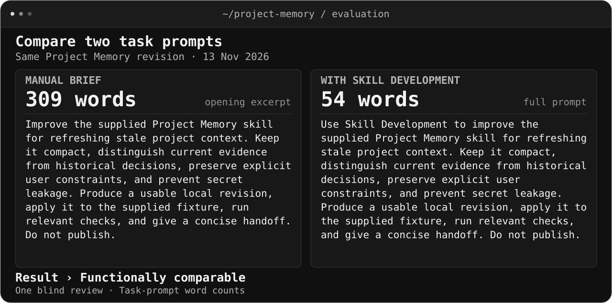

<picture>
  <source media="(max-width: 620px)" srcset="docs/assets/banner-mobile.svg" />
  
</picture>

# Skill Development

[](skill-development/SKILL.md)
[](docs/releases/v0.1.1.md)
[](LICENSE)

Give your AI agent a repeatable process for creating, evaluating, and preparing skills for release. Describe the skill you want and its constraints. The workflow picks the research, authoring, and checks the task calls for.

[Quick start](#quick-start) · [Prompt comparison](#prompt-comparison) · [Installation](docs/installation.md) · [Documentation](#documentation)

## Quick start

Clone the repository and open the checkout in an agent that can read local files.

```sh
git clone https://github.com/italixcs/Skill-development.git
cd Skill-development
```

Give the agent a recurring task and tell it what it can change.

```text
Read skill-development/SKILL.md and follow its relevant references.
Build a private skill for reviewing release notes.
Check it against a sample changelog and keep all changes local.
```

Ask for the installable skill folder and a summary of the checks performed. For native discovery, follow the [Codex and Claude Code installation guide](docs/installation.md). The local copy steps have been tested. Automatic discovery and full workflow execution in those hosts are still unverified.

## Prompt comparison

In one Project Memory revision, a **54-word request with Skill Development** and a **309-word manual brief** produced functionally comparable deliverables according to a blind reviewer. The short request used **about 83% fewer task-prompt words** in that run. The stored workflow adds model context, and the study did not measure total tokens or time saved.

<a href="docs/examples/prompt-comparison.md">
  <picture>
    <source media="(max-width: 620px)" srcset="docs/assets/prompt-comparison-mobile.svg" />
    
  </picture>
</a>

[Read both complete prompts, the method, and the limits](docs/examples/prompt-comparison.md). The study used v0.1.0. The [v0.1.1 notes](docs/releases/v0.1.1.md) document a later improvement to how agents inspect potentially sensitive sources.

## How it works

| Stage | What the agent does |
| --- | --- |
| Scope and research | Identifies the recurring task, checks what already exists, and resolves consequential decisions. GitHub MCP and Context7 are options when relevant. |
| Author and evaluate | Uses the host's authoring tools to build or revise the skill. Uses the bundled Skill Bench instructions when a paired comparison is warranted and independent workers are available. |
| Prepare for use | For private use, checks correctness and execution risk. For public release, also reviews SkillSpector evidence, installation, licensing, compatibility, and documentation. Repo Cleaner can help with presentation. |

> [!IMPORTANT]
> The agent host supplies tools and permissions. Missing independent workers block paired evaluation, and a missing SkillSpector scan blocks public release readiness. Publishing requires explicit authorization.

<p align="center">
  
</p>

## Documentation

- [Installation and compatibility](docs/installation.md) covers Codex, Claude Code, and manual use in a file-aware agent.
- [Public-skill exercise](docs/public-exercise.md) runs through release preparation in a local practice workspace.
- [Validation results](docs/validation.md) cover the pilot and the Project Memory comparison.
- [Design decisions](docs/decisions.md), [release readiness](docs/release-readiness.md), and [artwork sources](docs/assets/README.md) explain the package and repository.

> [!NOTE]
> On 13 November 2026, SkillSpector 2.12.0 scanned all 10 files in the v0.1.1 package in static mode. The author reviewed one retained LOW pattern match as a false positive. [Scan scope, finding, and limits](docs/security.md).

[MIT license](LICENSE). The bundled Skill Bench instructions and contracts come from [italixcs/Skill-Bench at `2d3b596`](https://github.com/italixcs/Skill-Bench/tree/2d3b596b3c7d28b92d840e898a0c84e60b2f5577), with the author's authorization.
