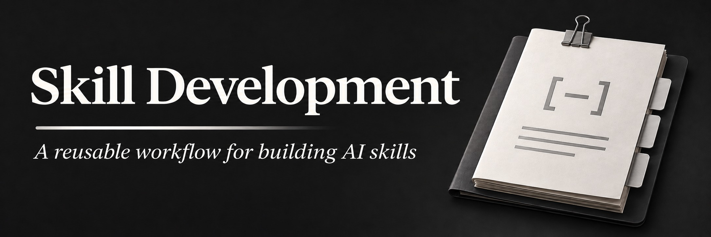

# Skill Development

[](docs/releases/v0.1.1.md)
[](LICENSE)

Reusable development rules for AI agent skills: research, scope, authoring, evaluation, security review, and release preparation.

Set the process once, then ask your agent to apply it to the next skill. Skill Development coordinates existing tools and keeps the steps proportional to the task. Its intended benefit is less repeated instruction and supervision. Human time savings have not been measured.

[Installation](docs/installation.md) · [Public-skill exercise](docs/public-exercise.md) · [Validation](docs/validation.md) · [Security](docs/security.md)

## See what it saves you writing


In one Project Memory revision, a **54-word request plus Skill Development** and a **309-word manual brief** produced functionally comparable results according to a blind reviewer. That is about **83% less task-prompt text** in this example. Stored skill instructions still add model context; this is not a claim of fewer total tokens or measured time savings.

[Read both complete prompts, results, and limits](docs/examples/prompt-comparison.md). The graphic shows the full short request and an explicitly labeled excerpt of the manual request. This study used v0.1.0; v0.1.1 adds safer source-inspection instructions.

## Try it

Clone or download this repository, inspect the complete [skill-development/](skill-development/) folder, then ask an agent with local file access:

```text
Read skill-development/SKILL.md and follow its relevant references.
Help me develop a private skill for reviewing release notes.
Research existing options, agree on the scope, and keep changes local.
```

For an existing skill:

```text
Use Skill Development to prepare this skill for public release.
Check the package, choose relevant evaluation, and use SkillSpector.
Prepare the documentation, report blockers, and do not publish.
```

These are usage examples, not transcripts of completed runs. See [host-specific installation](docs/installation.md) for Codex and Claude Code routes and their verification status. For a complete setup and copyable live trial, use the [public-skill exercise](docs/public-exercise.md).

> [!IMPORTANT]
> Tools and permissions come from your host. Missing independent agents or SkillSpector block their dependent checks; the workflow never invents a comparison or scan.

## What it coordinates

| Stage | Existing tool or capability | When used |
| --- | --- | --- |
| Research and scope | GitHub MCP, Context7, authoritative web/local sources | New ideas, unresolved facts, meaningful scope changes |
| Authoring and structure | Native skill creator and validator | Create or revise the package |
| Evaluation | Bundled, versioned Skill Bench workflow | Initial validation and meaningful behavior changes |
| Security | NVIDIA SkillSpector | Risk review and public release candidates |
| Presentation | Repo Cleaner | Installation, examples, evidence, or repository presentation needs |
| Publication | Existing Git/GitHub and release tools | Only with explicit authorization |

Research and authoring can use equivalent available capabilities. Skill Bench needs independent workers and a reviewer. SkillSpector must be installed separately. Repo Cleaner is optional; essential factual docs can be prepared without it. No external paid inference is initiated without agreement.

A private skill keeps essential correctness and execution-risk checks. A public release adds distribution, licensing, security evidence, compatibility, and documentation checks. A spelling fix receives affected checks; a meaningful behavior change receives representative evaluation. The workflow reuses decisions and authorization already given.

## Current version and evidence

**v0.1.1 is a usable early workflow.** It adds value suppression before potentially sensitive source content reaches tool output, with focused verification and a refreshed static scan. [Version notes](docs/releases/v0.1.1.md) describe the exact scope. The version badge does not certify stability or security.

The initial three-case pilot found **two ties and one narrow baseline preference**. A later prompt-substitution study found a tie with less task-specific text. These results support a concrete reuse example; they do not establish general output-quality or efficiency gains. [Validation record](docs/validation.md).

> [!NOTE]
> SkillSpector 2.12.0 inspected all 10 current package files in static mode on 2026-11-13. One LOW pattern match was retained and triaged as a false positive. See the [scope, hashes, and rationale](docs/security.md). This is not certification or proof of safety.

## Compatibility and limits

- The package follows the Agent Skills folder format. Host installation and invocation still vary.
- Codex and Claude Code copy routes are documentation-checked and locally copy-tested. Native discovery and full workflow execution in those clients remain unverified.
- Explicit instruction reading was exercised. Shared files/global capabilities meant best-effort isolation.
- ChatGPT Work distribution is manual/installer-dependent; this repository is not a registered plugin or marketplace listing.
- Static scans do not evaluate runtime containment or every possible attack.
- Raw task inputs, worker artifacts, controller mappings, and unsanitized reports stay outside the repository.

## Package and provenance

[SKILL.md](skill-development/SKILL.md) routes to conditional references. The package contains no executable scripts and does not install tools automatically. [Design decisions](docs/decisions.md) explain its scope; [visual provenance](docs/assets/README.md) identifies the branding illustration and exact prompt graphic.

[MIT license](LICENSE). Skill Bench instructions and contracts are reused from [Italixcs/Skill-Bench](https://github.com/italixcs/Skill-Bench) at commit `2d3b596b3c7d28b92d840e898a0c84e60b2f5577`, with the author's authorization. External tools retain their own licenses.
