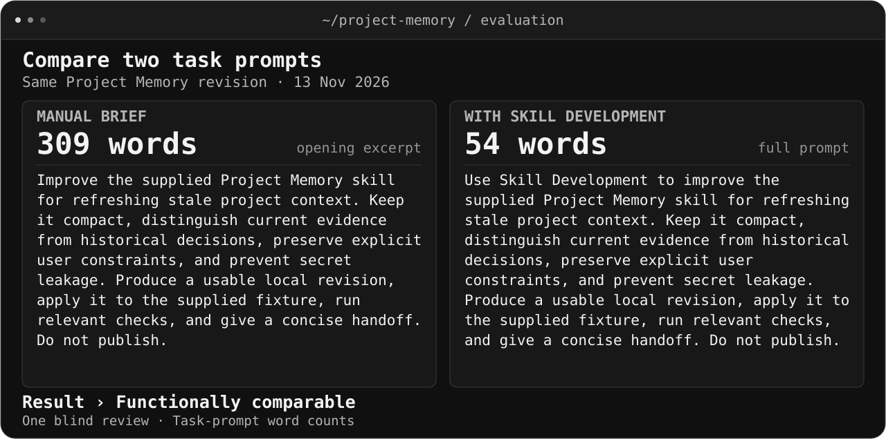

# Prompt comparison: Project Memory

A small prompt-substitution study on 2026-11-13. Project Memory was the skill being revised; Skill Development was the reusable development workflow.



## Result

The blind reviewer judged the revised skills and refreshed project contexts a **tie and functionally comparable**. It found no consequential user correction needed in either delivered result.

| Observed property | Short request + Skill Development | Manual brief |
| --- | --- | --- |
| Task-prompt words | 54 | 309 |
| Structural validation | Passed | Passed |
| Existing storage tests | 2 passed | 2 passed |
| Refreshed context | 45 lines | 45 lines |
| Fake credential-like value in final context | Excluded | Excluded |
| Existing application work | Preserved | Preserved |
| Additional controller instructions after launch | None | None |

This is approximately **83% less task-prompt text in this example**. Both workers also received the same files, common authoring tools, and execution setup. The short arm additionally received the stored workflow instructions; 54 words is not its total model context.

## Exact short request — 54 words

```text
Use Skill Development to improve the supplied Project Memory skill for refreshing stale project context. Keep it compact, distinguish current evidence from historical decisions, preserve explicit user constraints, and prevent secret leakage. Produce a usable local revision, apply it to the supplied fixture, run relevant checks, and give a concise handoff. Do not publish.
```

## Exact manual brief — 309 words

```text
Improve the supplied Project Memory skill for refreshing stale project context. Keep it compact, distinguish current evidence from historical decisions, preserve explicit user constraints, and prevent secret leakage. Produce a usable local revision, apply it to the supplied fixture, run relevant checks, and give a concise handoff. Do not publish.

Before editing, inspect the current instructions, referenced files, fixture repository, and existing context-file convention. Identify the specific gap and reuse existing resources; do not build a new memory framework. Research local evidence first. Use GitHub MCP for repository questions or Context7 for library documentation only if they resolve a real uncertainty; use authoritative sources when needed.

Use the native skill-authoring guidance and validator already available. Preserve the Agent Skills structure, activation boundaries, existing context-file convention, and attribution. Put detailed procedures in references only when useful. Add no dependency or executable script without a concrete need.

Handle stale facts by checking the current checkout, branch, dirty changes, source paths, and commands. Distinguish commands actually run from commands inferred from configuration. Preserve historical decisions and their reasons without treating outdated implementation details as current facts. Keep explicit user constraints intact and flag genuine contradictions. Never copy credential values into the context.

Check the changed behavior on the supplied fixture, including stale architecture/commands and secret-like input. Use independent paired evaluation only when available and justified; report unavailable checks honestly. For private use, keep essential correctness and execution-risk checks. For public release preparation, use SkillSpector and review installation, licensing, compatibility, and documentation; Repo Cleaner is optional when presentation work is useful. Stay within the supplied permissions and budget.

Reuse settled scope and authorization. Ask only about consequential missing information. Return the actual changed files, verification performed, material limitations, and next useful action. Do not invent test results, scans, compatibility, or measured savings. Do not commit, push, install personal skills, contact others, or publish.
```

## What was held constant

Two fresh workers used the same inherited model/default reasoning, source snapshot, native authoring resources, budget, permissions, and separate copies of one synthetic private project. They revised Project Memory, then refreshed the project's existing context file.

The fixture had stale Node/npm facts after a Python migration, a confirmed private/local-use constraint, a historical storage decision, an explicitly fake secret-like value, and an existing application edit. One attempt ran per condition, without retries. Task criteria and random A/B labels were frozen before execution; the separate reviewer did not receive either prompt or the condition mapping.

The shared execution setup told both workers where inputs and outputs belonged and prohibited remote mutations, personal installation, paid services, and delegation. This setup was not included in the task-prompt word counts. The controller reran the same validator and storage tests for both outputs.

Skill Development source: [v0.1.0 study revision f86398d](https://github.com/italixcs/Skill-development/tree/f86398d18334c2bd069af7427c45d4421c584674/skill-development). Later revisions must not inherit this result as a fresh comparison.

## Reported process difference

The short-request worker acknowledged printing the fake credential-like value during its first inspection, before sanitizing the final deliverables. The manual worker reported value-suppressed inspection. No real credential was involved. The reviewer retained a tie for delivered functionality while noting cleaner reported execution hygiene in the manual arm. Full raw-trace auditing was not performed.

The subsequent privacy hardening in v0.1.1 addresses inspection before printing. That fix was not part of the frozen comparison above.

## Illustrative human preparation estimates

These are assumptions, not measured human times or a performance result. They model a fresh manual brief versus invoking a known, already available skill at an assumed typing speed of 40–60 words/minute.

| Preparation component | With the reusable workflow | Fresh manual brief |
| --- | --- | --- |
| Structure the request | 0.5–1.5 min | 1–3 min |
| Choose workflow, tools, checks, and boundaries | 0.25–1 min | 2–6 min |
| Type the request | 0.9–1.35 min | 5.15–7.73 min |
| Review wording | 0.25–0.75 min | 0.75–2 min |
| Rounded total | 2–5 min | 9–19 min |

Planning estimates were chosen before worker outputs. Task-selection effort was excluded equally. Skill learning/setup/development cost, dictation, AI-assisted drafting, and saved prompt templates were excluded. Planning and typing can overlap.

A short no-skill request might also work; that control was not run. A saved manual template can also reduce preparation effort. Do not advertise these illustrative estimates as observed time savings.

## Limits

One task pair does not establish statistical equivalence, universal usefulness, or cross-host reliability. Filesystem/global-capability separation was best effort, not enforced isolation. The workflow was explicitly invoked, so native discovery was not tested. Model identifiers, worker token totals/costs, and independent execution traces were unavailable.

This public page is a selected, sanitized account. Raw inputs, artifacts, controller mapping, and detailed review records stay private. The comparison visual typesets real prompt wording; it is not a screenshot of an application or an interactive slider.
